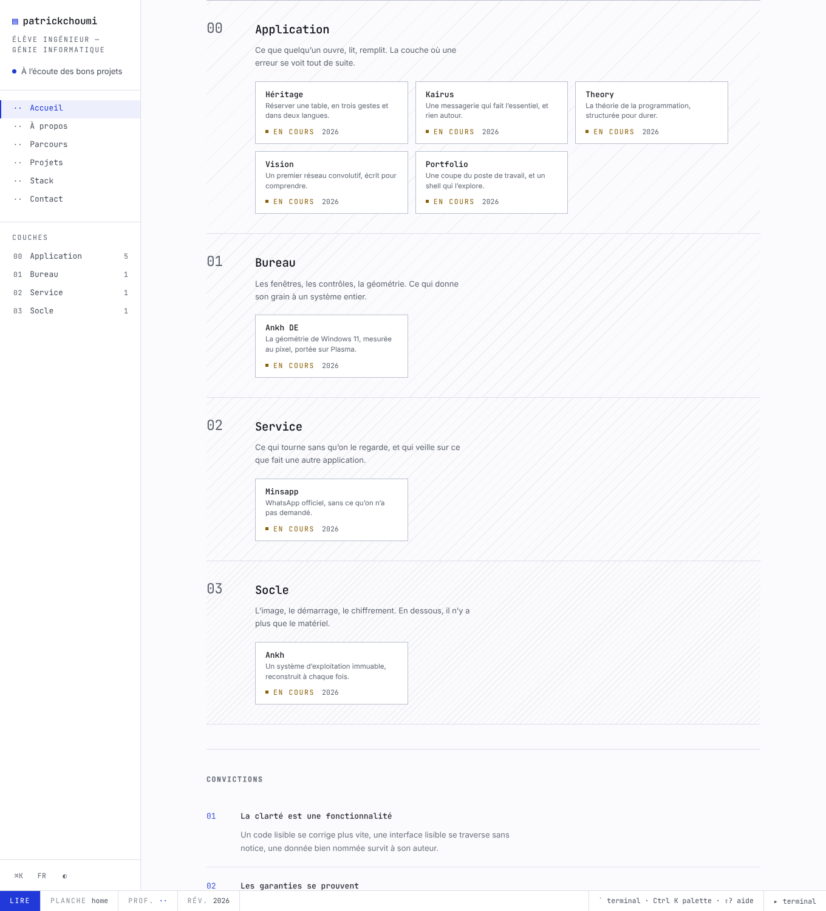
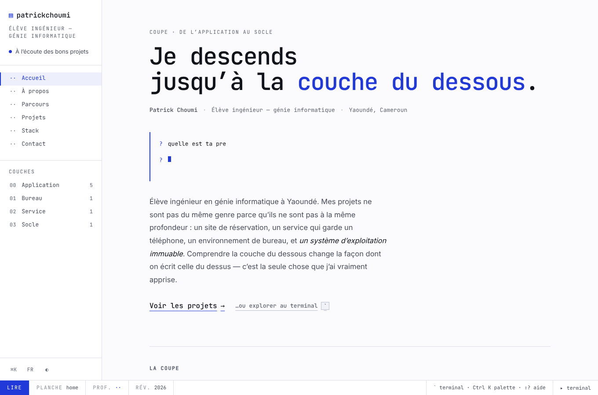
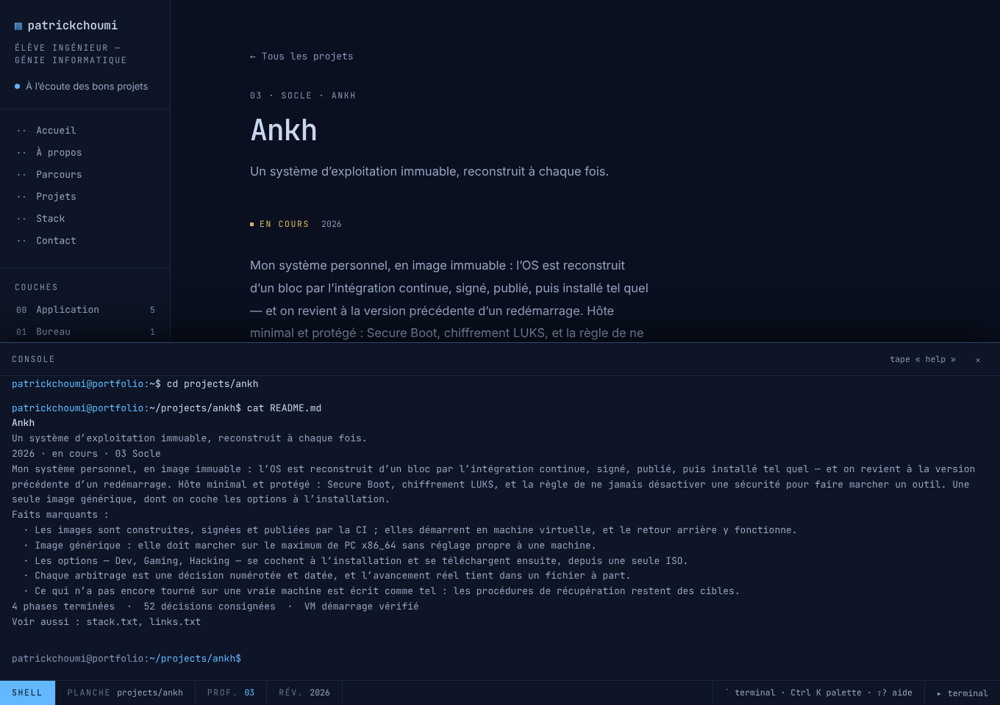
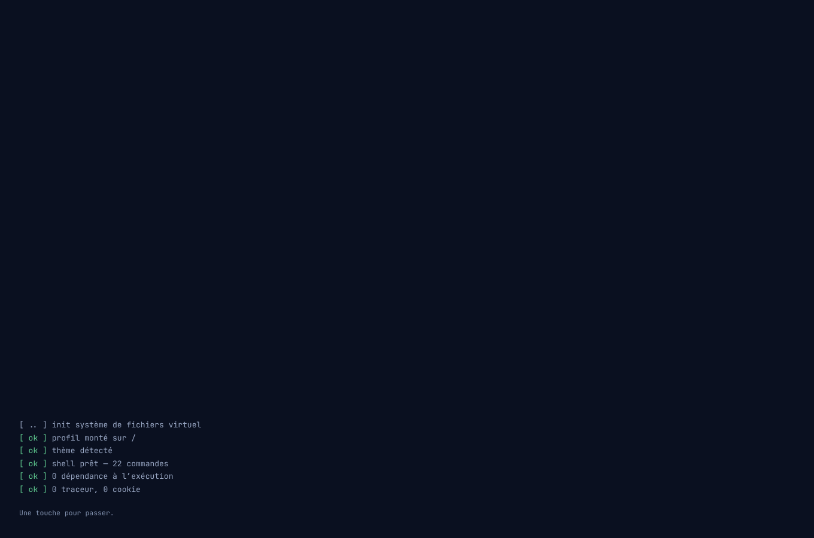
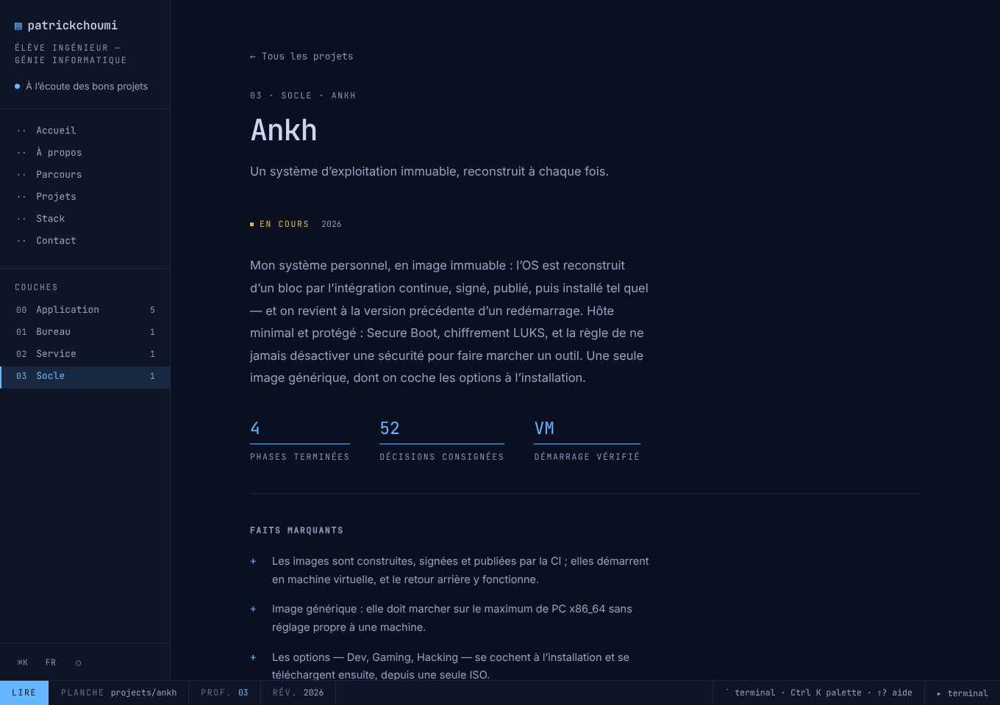

# patrickchoumi/portfolio

Un portfolio en coupe.

Les projets qu'il présente ne sont pas du même genre, parce qu'ils ne sont pas
à la même profondeur : un site de réservation, un service qui garde un
téléphone, un environnement de bureau, et un système d'exploitation immuable.
L'accueil est donc une coupe technique — chaque projet posé à la couche où il
travaille, de l'application jusqu'au socle. Et le même contenu s'explore aussi
à la commande, dans une console rangée dans le cartouche.



---

## L'idée

Un portfolio classique décrit la façon de travailler de son auteur. Celui-ci
la met en pratique sous les yeux du visiteur :

| Ce qui est affirmé | Ce qui le prouve, dans le site même |
| --- | --- |
| « Peu de dépendances » | zéro dépendance à l'exécution ; 39 Ko gzip de code (HTML + CSS + JS), plus 160 Ko de polices auto-hébergées |
| « Rien n'est envoyé nulle part » | aucune requête vers un tiers — polices auto-hébergées, aucun traceur, aucun cookie ; un test échoue si un hôte externe est contacté |
| « Les garanties se prouvent » | 49 tests unitaires + 31 vérifications navigateur, en CI — dont le responsive, le contraste et l'indexation, mesurés plutôt qu'affirmés |
| « La clarté est une fonctionnalité » | un seul fichier de données, dont la page, le terminal, la palette et le CV imprimé dérivent |

## Démarrer

```bash
npm install
npm run dev          # http://localhost:5173
```

| Commande | Effet |
| --- | --- |
| `npm run dev` | serveur de développement |
| `npm run build` | build de production dans `dist/` |
| `npm run preview` | sert le build, avec repli SPA |
| `npm test` | tests unitaires (logique pure, sans navigateur) |
| `npm run test:e2e` | build + harnais navigateur (Chromium) |
| `npm run check` | tout : tests, build, harnais |
| `npm run fonts` | re-télécharge et auto-héberge les polices |

`npm run build` régénère `sitemap.xml` et `robots.txt` avant de compiler.

## Personnaliser : un seul fichier

Tout le contenu vit dans **`src/data/profile.js`**. Il n'y a pas de texte en
dur dans le HTML, pas de « version texte » à tenir à jour en parallèle.
Modifier ce fichier met à jour, d'un coup :

- la page (accueil, à propos, parcours, projets, stack, contact) ;
- l'arborescence du terminal et le contenu de chaque fichier virtuel ;
- l'index de la palette de commandes ;
- le CV que produit `cv`, et la version imprimée du site.

Chaque champ traduisible est un objet `{ fr, en }`. Une chaîne nue est
utilisée telle quelle dans les deux langues (pratique pour les noms propres).

```js
export const projects = [
  {
    slug: 'ankh',                     // → /projets/ankh et projects/ankh/
    name: 'Ankh',
    year: '2026',
    status: 'wip',                    // live | wip | planned | archived
    layer: 'socle',                   // ← la couche : elle place le projet dans la coupe
    tagline: { fr: '…', en: '…' },
    summary: { fr: '…', en: '…' },
    highlights: { fr: ['…'], en: ['…'] },
    metrics: [{ label: { fr: 'commits/s', en: 'commits/s' }, value: '~9k' }],
    stack: ['Node', 'Git'],
    links: [{ label: { fr: 'Code', en: 'Source' }, url: 'https://…' }]
  }
];
```

L'audit de contenu (`npm test`) refuse les dérives courantes : slug dupliqué,
traduction manquante, nombre de faits marquants différent entre les langues,
parcours qui n'est plus antéchronologique, accroche trop longue pour sa
rangée, lien relatif là où il faut une URL absolue, ou nom de techno accentué
laissé en français dans la version anglaise.

**`status` sert à ne pas mentir.** Un projet qui n'est pas commencé n'est ni
`live` ni `wip` : il est `planned`, et la page l'affiche « à venir », en gris
plutôt qu'en couleur. La description dit alors une intention, pas un résultat.

> ⚠️ Si tu repars de ce dépôt : le contenu de `profile.js` est le parcours de
> son auteur. Remplace-le par le tien avant de publier.




## Le terminal



Ouvrir : <kbd>`</kbd> ou <kbd>²</kbd> (même touche physique en AZERTY), ou le
bouton `▸ terminal` du cartouche.

```
/
├── about.md          principles.md    resume.md    contact.md
├── experience/       README.md (git log) + un .md par poste
├── projects/         un dossier par projet : README.md, stack.txt, links.txt
└── stack/            un .txt par groupe
```

Vingt-deux commandes : `ls` (`-a`, `-l`), `cd`, `pwd`, `cat`, `tree`, `find`,
`grep`, `open`, `whoami`, `neofetch`, `cv`, `print`, `mail`, `theme`, `lang`,
`history`, `clear`, `date`, `echo`, `uname`, `exit` — plus quelques-unes qui
ne sont pas dans `help`.

- <kbd>Tab</kbd> complète les commandes et les chemins (préfixe commun le plus long) ;
- <kbd>↑</kbd> <kbd>↓</kbd> parcourent un historique persistant ;
- <kbd>Ctrl</kbd>+<kbd>L</kbd> efface, <kbd>Ctrl</kbd>+<kbd>C</kbd> annule, <kbd>Échap</kbd> ferme ;
- un pipe est accepté, vers `grep` uniquement : `cat about.md | grep clarté` ;
- une commande mal tapée propose la plus proche (distance de Levenshtein).

Le terminal est un **bonus, jamais un péage** : tout le contenu est lisible
sans jamais l'ouvrir.

## La séquence de démarrage



Le site s'ouvre sur un log de boot. C'est une petite mise en scène assumée —
elle annonce la couleur en trois secondes — mais elle est tenue par trois
garde-fous, sans quoi elle deviendrait une nuisance :

- **une seule fois par session** (`sessionStorage`) : recharger la page ne la
  rejoue pas ;
- **jamais sur un lien profond** : arriver sur `/projets/theory` depuis un
  lien partagé doit montrer la fiche, pas un écran de chargement ;
- **jamais en `prefers-reduced-motion`**, et n'importe quelle touche ou un
  clic la coupe immédiatement.

Les trois se vérifient dans le harnais navigateur : chacun peut se casser sans
rien casser d'autre. Le nombre de commandes annoncé (« shell prêt — 22
commandes ») est compté sur le registre, pas écrit à la main.

## Raccourcis clavier

| Touche | Effet |
| --- | --- |
| <kbd>`</kbd> / <kbd>²</kbd> | ouvre ou ferme le terminal |
| <kbd>Ctrl</kbd>/<kbd>⌘</kbd>+<kbd>K</kbd> | palette : sections, fichiers, commandes, liens |
| <kbd>?</kbd> | ouvre le terminal sur `help` |
| <kbd>Échap</kbd> | ferme ce qui est ouvert |

## Architecture

```
index.html              charpente : des conteneurs, aucun contenu
src/data/profile.js     ← la source unique de vérité
src/data/fs.js          projette profile.js en arborescence explorable
src/data/lang.js        sélection de langue (pur, testable)
src/js/main.js          orchestration — une route, deux vues
src/js/render.js        rendu de la page depuis les données
src/js/shell.js         moteur du terminal (historique, complétion, pipe)
src/js/commands.js      registre des commandes (pur, testable)
src/js/palette.js       palette Ctrl+K
src/js/router.js        routes réelles (History API), analyse pure
src/js/i18n.js          FR/EN, sans rechargement
src/js/repl.js          le REPL animé de l'accueil
src/js/boot.js          séquence de démarrage (une fois par session)
src/js/seo.js           titre, description et canonique par route
src/js/effects.js       révélation au défilement + easter egg
src/styles/main.css     design system « la coupe »
scripts/fetch-fonts.mjs auto-hébergement des polices
scripts/build-sitemap.mjs sitemap.xml + robots.txt, dérivés des routes
tests/                  49 tests node:test — logique pure
tests-e2e/browser.mjs   31 vérifications navigateur
```

Le principe structurant : **`navigate()` est le seul point de passage**. Clic
dans le rail, entrée de la palette, commande `cd`, bouton Précédent du
navigateur, lien profond — tout converge au même endroit, qui met à jour la
section, l'URL, la tête du document, le rail, le cartouche et le répertoire
courant du shell.

## La direction

Les deux versions précédentes de ce site imitaient un éditeur de code :
onglets de buffer, gouttière de numéros de ligne, arborescence de fichiers.
C'était juste tant que les projets étaient des sites. Ils ne le sont plus — il
y a maintenant un OS immuable, un environnement de bureau en Qt, des unités
systemd, un service Android. Un portfolio qui ressemble à VS Code dit
« développeur web » d'un auteur qui passe ses nuits sous la ligne de flottaison.

**D'où la coupe.** Le fait le plus intéressant de ces projets n'est pas leur
technologie, c'est leur profondeur. `profile.js` déclare quatre couches, chaque
projet en désigne une, et tout le reste en découle : la coupe de l'accueil, le
rail de gauche, le groupement de la liste, la cote du cartouche, et jusqu'à la
première ligne du README virtuel au terminal. Un projet dont la couche
n'existe pas ferait échouer `npm test`, et une couche sans projet aussi.

Trois règles tiennent le dessin.

**1. On descend.** La profondeur est l'axe du site : cotée à gauche de 00 à 03,
elle ordonne tout ce qui est listé. Rien n'est trié par date quand il peut
l'être par couche. Les **hachures** ne sont pas un ornement : leur densité est
l'information. Elles se resserrent à mesure qu'on descend — c'est la convention
d'une coupe géotechnique, et elle rend la profondeur lisible sans lire une
seule étiquette. On les coupe à l'impression, où elles mangeraient le texte.

**2. Le trait, pas la boîte.** Un filet d'un pixel, des hachures, une cote.
Aucune carte, aucune ombre portée, aucune pastille arrondie. Ce qui sépare,
c'est une ligne ; ce qui qualifie, c'est une étiquette en capitales à chasse
fixe. Les chiffres d'une fiche projet sont **cotés** comme sur un plan : la
valeur, un filet qui se trace, l'unité.

**3. Deux encres sur deux papiers.** En clair, un papier froid et une encre
indigo. En sombre, le bleu de plan et un cyan qui s'y lit. Le sombre n'est pas
le clair inversé : ses fonds sont choisis, et l'accent y est repris à une
clarté qui tient dessus. Un vert phosphore puis un bleu de dossier avaient
précédé — le premier tirait vers l'écran cathodique, le second désignait un
fichier là où il s'agit maintenant de tracer une ligne.

- **Typographie** : JetBrains Mono pour l'ossature, Inter pour la prose, toutes
  deux auto-hébergées. Elles n'ont pas changé, et c'est délibéré : le site
  garantit qu'aucune requête ne sort vers un tiers, et une police de plus
  serait 60 Ko pour un effet que le dessin obtient déjà.
- **Le terminal reste, mais il change de statut.** Ce n'est plus la métaphore
  qui organise le site, c'est un outil rangé dans le cartouche. Quelqu'un qui
  écrit un système d'exploitation a une console sous la main ; ça n'en fait pas
  un décor.
- **Mouvement** : `prefers-reduced-motion` coupe le REPL animé, la séquence de
  démarrage, la révélation au défilement et le tracé des cotes.

Ce qui a été retiré en passant à cette version, et pourquoi :

| Retiré | Pourquoi |
| --- | --- |
| Les onglets de buffer | Ils répétaient le rail, en travers de la lecture, et appartenaient à la métaphore de l'éditeur. |
| La gouttière de numéros de ligne | Du bruit sur chaque écran pour une métaphore que le site ne revendique plus. |
| L'arborescence de fichiers comme navigation | Remplacée par l'échelle de profondeur : elle dit quelque chose du contenu, pas seulement de sa forme. |
| La fenêtre à pastilles du REPL | Un objet d'interface de plus ; il ne lui reste qu'un filet en marge, comme une annotation. |
| Les pastilles de technologie | Douze boîtes arrondies là où des mots séparés d'un point médian suffisent. |



## Indexation

Le site est déclaré dans la Google Search Console sur
`https://patrickchoumi.vercel.app`. Trois choses le rendent indexable, et
chacune est vérifiée par le harnais.

> Rien de tout cela n'agit tant que la branche déployée ne porte pas ces
> commits : la Search Console lit le site **en ligne**, pas le dépôt.

**La preuve de propriété.** Elle est posée par la **balise meta**, dans le
`<head>` statique d'`index.html` — c'est la méthode la plus simple, et la plus
robuste : rien à servir, rien qu'un repli de routage puisse intercepter.

```html
<meta name="google-site-verification" content="…" />
```

Elle doit survivre à deux choses, et un test le vérifie : au rendu (`seo.js`
réécrit la tête du document à chaque route — le jour où quelqu'un lui fera
*reconstruire* la tête au lieu de la modifier, la balise disparaîtrait et
Google dévaliderait le site en silence) et à la bascule de langue, qui
reconstruit page, arbre et invite.

La preuve par fichier (`public/google7589f0063f878c18.html`) est conservée en
second témoin — Google accepte plusieurs méthodes, et deux valent mieux
qu'une. Elle a son propre piège, que le `vercel.json` désamorce : tout chemin
inconnu retombe sur `index.html`, et un fichier de vérification qui passe par
ce repli fait lire à Google la page d'accueil au lieu du jeton. La réécriture
exclut donc tout chemin portant une extension.

**Ne supprime ni l'un ni l'autre après validation** : Google les revérifie
périodiquement, et les retirer fait perdre la propriété du site.

**Une tête de document par route.** Le site a onze URL mais un seul fichier
HTML : sans rien, les onze partagent le même `<title>` et la même description,
et ne sont qu'une seule page pour un moteur. `src/js/seo.js` est branché sur
`navigate()` — le point de passage unique — et pose à chaque route son titre,
sa description (coupée proprement avant les 160 caractères que Google
affiche), son canonique et ses balises Open Graph. Le canonique est déduit de
`location.origin`, pas d'un domaine écrit en dur : il reste juste en
préproduction, et il n'y a rien à reconfigurer le jour d'un nom de domaine
personnel. Un test échoue si deux routes partagent un titre.

**Un sitemap calculé.** `scripts/build-sitemap.mjs` dérive `sitemap.xml` et la
ligne `Sitemap:` de `robots.txt` du routeur et de `profile.js`, à chaque
build : ajouter un projet ajoute son URL. Une liste tenue à la main dérive à
la première modification et finit par pointer vers des 404 — le harnais visite
d'ailleurs chaque URL du sitemap pour vérifier qu'elle répond.

Il reste à faire, une fois en ligne : *Sitemaps* → soumettre
`https://patrickchoumi.vercel.app/sitemap.xml`, puis *Inspection de l'URL* →
**Demander une indexation** sur l'accueil. Compter quelques jours.

Une limite assumée : la langue suit celle du navigateur sans changer l'URL. Il
n'y a donc pas de `hreflang` à déclarer — une seule adresse sert les deux
langues, et Google indexera celle que son robot déclenche.

## Responsive et accessibilité

Rien de tout cela n'est déclaratif : cinq vérifications du harnais parcourent
les sept routes à huit largeurs — de 320 px, le plus petit téléphone encore en
circulation, à 1920 px — et échouent si l'une des garanties suivantes cède.

| Garantie | Comment elle est tenue |
| --- | --- |
| Aucun défilement horizontal | mesuré sur chaque route à chaque largeur |
| Cibles tactiles ≥ 24 px | WCAG 2.2, critère 2.5.8 (AA), sur tout ce qui est cliquable |
| Contraste AA | 4,5:1 (3:1 pour le grand texte), dans les **deux** thèmes, en composant les fonds semi-transparents |
| Le terminal utilisable au doigt | on ouvre, on tape `cd`, on vérifie que ça répond — sur 320 px |
| Barre latérale escamotée hors du clavier | fermée, elle sort aussi du parcours de tabulation |

Trois défauts réels ont été trouvés de cette façon, et corrigés :

- **Le champ de saisie du terminal tombait à zéro pixel de large.** L'invite
  `patrickchoumi@portfolio:~/projects/kairus$` fait 335 px et ne rétrécit pas :
  sur un téléphone il ne restait plus rien pour taper. La rangée passe
  désormais à la ligne, le champ garde un plancher de 12 caractères, et
  au-dessous de 520 px l'invite abandonne `user@host` pour ne garder que le
  chemin — l'arbitrage de n'importe quel `PS1` dans un terminal serré.
- **La barre latérale escamotée restait tabulable.** Hors de l'écran par un
  `translateX`, elle laissait traverser six liens invisibles avant le contenu,
  et un lecteur d'écran les annonçait. Elle passe en `visibility: hidden`,
  qui se transitionne — l'animation d'ouverture est conservée.
- **`--text-tertiary` mentait sur son propre contraste.** Le token annonçait
  « ≥ 4,5:1 sur `--bg` », ce qui était vrai — mais il servait surtout sur
  `--surface-2`, où il tombait à 4,15:1. Recalé sur le pire cas.

Par ailleurs : lien d'évitement, navigation entièrement au clavier,
`:focus-visible` visible partout, un seul `h1` par section et aucun saut de
niveau, `aria-current="page"` sur l'entrée courante, sortie du terminal en
`role="log"` / `aria-live="polite"`, animations coupées sur demande du
système.

## Déploiement

Le build produit un `dist/` entièrement statique. Le site utilise des routes
réelles : configure le repli SPA vers `index.html`.

| Hébergeur | À faire |
| --- | --- |
| Netlify | `/* /index.html 200` dans `_redirects` |
| Vercel | `vercel.json`, déjà dans le dépôt |
| Cloudflare Pages | automatique |
| nginx | `try_files $uri $uri/ /index.html;` |
| GitHub Pages | copier `index.html` en `404.html` |

Le repli ne doit pas avaler les fichiers servis tels quels — la preuve de
propriété Google, `sitemap.xml`, `robots.txt`, les polices, les assets. D'où
la négation sur l'extension dans `vercel.json`, et deux tests qui l'éprouvent
hors ligne : l'un vérifie que chaque route réelle est bien réécrite, l'autre
qu'aucun de ces fichiers ne l'est.

> ⚠️ **`vercel.json` est du JSON : il n'accepte aucun commentaire.** Le schéma
> de Vercel est *fermé* — une seule propriété inconnue fait échouer le
> déploiement entier, et le dépôt n'en montre rien : le site en ligne reste
> simplement figé sur une version ancienne. C'est arrivé ici, une clé
> `comment` glissée dans la règle de réécriture, et plusieurs jours de
> déploiements silencieusement refusés. Le premier test de
> `tests/deploy.test.mjs` existe pour ça, et la justification de la règle vit
> dans son en-tête, là où les commentaires sont légaux.

## Licence

Le code est réutilisable. Le contenu (parcours, projets, textes) appartient à
son auteur — remplace-le par le tien. Les polices sont sous SIL Open Font
License 1.1 (voir `public/fonts/LICENSE.txt`).
